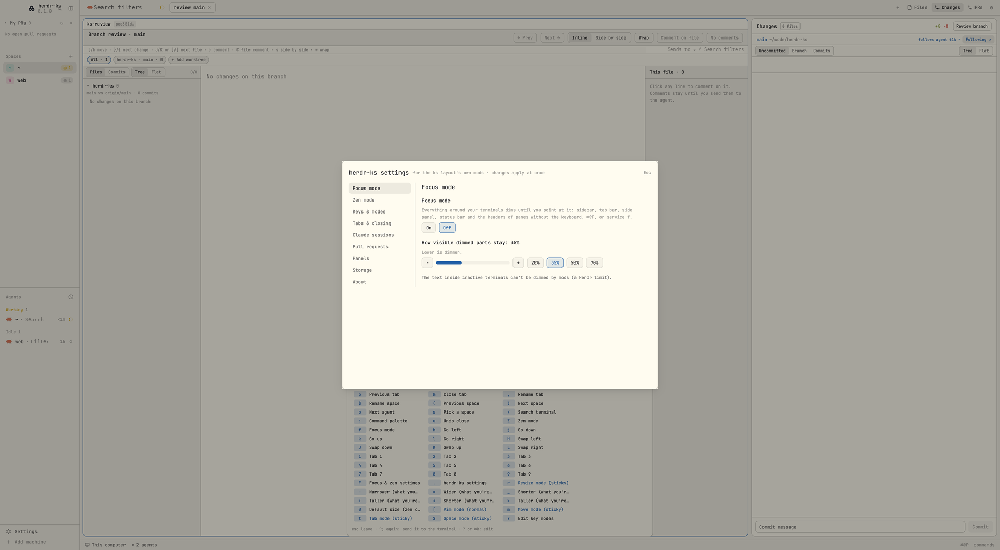

# herdr-ks

**Run several coding agents at once, each in its own git worktree, and review what they did without leaving the window.**



## What it is

[Herdr App](https://herdr.dev) is a desktop app for terminals and coding agents. A *layout* decides what its
window shows. `ks` is a layout: it adds a sidebar, side panels and review tools around your terminals, built
for working with agents across worktrees and more than one repo (a backend and a frontend, say).

It installs next to whatever you already use in Herdr and changes nothing else.

- **See everything running.** Spaces grouped by repo and worktree, and every agent with its status and task. [More](docs/GUIDE.md#the-window)
- **One step to a new worktree.** Repo, branch, folder, Enter: a new space opens in the checkout. [More](docs/GUIDE.md#spaces-worktrees-and-new-worktrees)
- **Changes that follow the agent.** The diff panel shows the checkouts an agent is working in, across repos on the same branch. [More](docs/GUIDE.md#changes-panel)
- **Review like a pull request.** A file or a whole branch, inline or side by side, with vim keys. [More](docs/GUIDE.md#reviewing)
- **Send comments to the agent.** Comment on any line, then send them all in one message. [More](docs/GUIDE.md#comments-and-sending-them-to-an-agent)
- **Pull requests in view.** Your open PRs with CI, review and merge state; message the agent on a PR, or start one. [More](docs/GUIDE.md#pull-requests)
- **Notes and tasks.** A scratchpad and a kanban board per space, which agents can add to with `ks-task`. [More](docs/GUIDE.md#tasks)
- **Nothing lost.** Sessions resume after a reboot, and a closed tab or space can be undone for 30 s. [More](docs/GUIDE.md#resuming-claude-sessions-after-a-reboot)
- **Keyboard first.** tmux-style and vim-style key modes, zen mode and focus mode. [More](docs/GUIDE.md#key-modes)

The [guide](docs/GUIDE.md) is the full tour.

## Set up

You need macOS, [Herdr App](https://herdr.dev) (started once), `git` and `jq` (`brew install jq`).
Pull request features need the GitHub CLI, signed in (`gh auth login`). Following an agent and resuming
sessions need `python3`, and work with Claude Code.

```sh
git clone https://github.com/kyriacos/herdr-ks.git
cd herdr-ks
scripts/install.sh --switch
```

The script copies the layout and its `ks-*` mods into `~/.config/herdr-app`, adds its own section to
`keys.json` (a backup is kept), checks every mod and switches the window to the layout.

Then, in Settings (⚙ in the tab bar, or `cmd-shift-,`):

| Setting | Default | What it is |
|---|---|---|
| Spaces & agents > Worktree folder | `~/code/worktrees` | New worktrees go to `<folder>/<repo>/<branch>` |
| Pull requests > Repo folders | `~/code` | Where your clones live, comma-separated |

`ctrl-shift-l` switches to another layout. To remove `ks`, delete `layouts/ks.*`, the `mods/ks-*` folders
and the `layout:ks` section of `keys.json` in `~/.config/herdr-app`.

## Keys

These work only while the layout shows. [All keys](docs/GUIDE.md#all-keys) are in the guide.

| Key | Does |
|---|---|
| `cmd-shift-n` | New space + worktree |
| `cmd-shift-e` / `g` / `u` | Files / Changes / PRs panel |
| `cmd-shift-j` / `k` | Notes / Tasks panel |
| `cmd-shift-m` | Show or hide My PRs |
| `cmd-shift-t` | Undo the last close |
| `ctrl-;` | Key mode (a strip shows its keys) |
| `cmd-shift-z` / `f` | Zen mode / Focus mode |
| `cmd-shift-,` | Settings |

## Updates

The logo menu checks this repo's [releases](https://github.com/kyriacos/herdr-ks/releases) once a day and
offers to update with an agent, which asks before it changes anything. By hand: `git pull`, then
`scripts/install.sh`.

## Goes well with

[cockpit](https://github.com/quaresc/cockpit) shows every agent with its ticket, pull request, CI run and
deploy, and lets agents draw charts, diffs and plans beside the session. Separate and optional.

```
/plugin install cockpit --marketplace quaresc/cockpit
/cockpit:setup
```

## More

- [Guide](docs/GUIDE.md): every feature, and troubleshooting.
- [Contributing](CONTRIBUTING.md): how the repo is built and how to change it.
- [AGENTS.md](AGENTS.md): rules for agents working here, and what must never be committed.

## Thanks

Inspired by [Herdr Roundup](https://github.com/carstenlucke/herdr-roundup): thank you for the starting point.
Licences and notices are in `LICENSE` and `THIRD_PARTY_NOTICES.md`.
